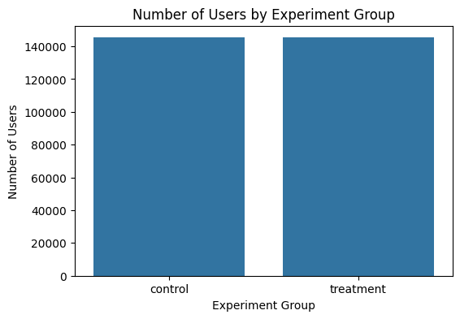
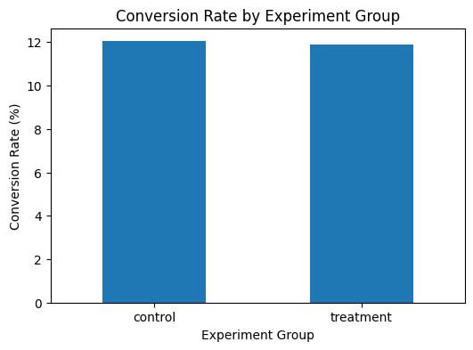
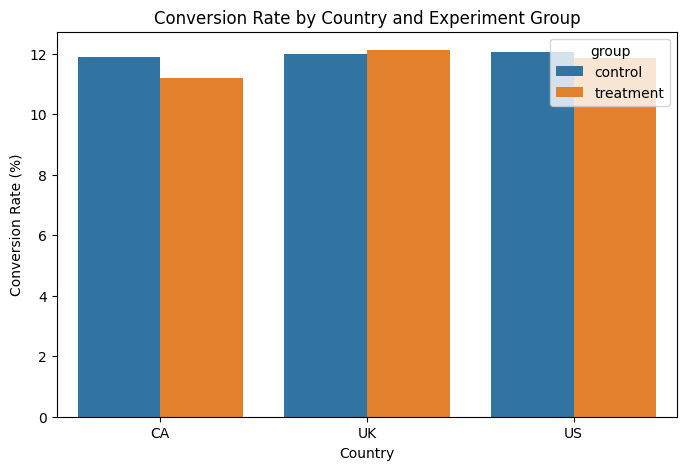

# A/B Testing Analysis: New vs. Old Landing Page

## 📌 Project Overview

This project analyzes the results of an A/B test conducted to determine whether a **new landing page** improves user conversion compared to the existing landing page.

Users were divided into two groups:

* **Control Group:** Viewed the existing `old_page`
* **Treatment Group:** Viewed the redesigned `new_page`

The primary goal was to determine whether the new landing page produced a statistically and practically meaningful improvement in conversion.

---

## 🎯 Business Problem

A company introduced a new landing page and wants to determine whether it performs better than the existing page.

The key business question is:

> **Should the company replace the existing landing page with the new landing page?**

The decision is based on whether the new page produces a meaningful improvement in user conversion.

---

## 📊 Dataset

The project uses two datasets:

### `ab_data.csv`

Contains the A/B experiment data:

* `user_id` — Unique identifier for each user
* `timestamp` — Time associated with the experiment record
* `group` — Experiment group (`control` or `treatment`)
* `landing_page` — Landing page shown to the user (`old_page` or `new_page`)
* `converted` — Conversion outcome (`1` = converted, `0` = not converted)

### `countries_ab.csv`

Contains geographical information for users:

* `user_id`
* `country`

The country dataset was used for a secondary exploratory analysis.

---

## 🛠️ Tools & Technologies

* Python
* Pandas
* NumPy
* Matplotlib
* Seaborn
* SciPy
* Statsmodels
* Jupyter Notebook

---

## 🔍 Analysis Workflow

### 1. Data Inspection

The datasets were inspected for:

* Dataset structure
* Missing values
* Duplicate records
* Duplicate users
* Experiment group distribution
* Landing page assignments

---

### 2. Data Quality Investigation

Several data quality issues were investigated, including:

* Users appearing multiple times
* Users assigned to inconsistent experiment groups
* Mismatches between experiment groups and landing pages

Invalid experiment assignments were removed, and duplicate users were handled to ensure that each user was represented only once in the final dataset.

---

### 3. Experiment Validation

Before evaluating conversion performance, the experiment allocation was validated.

A **Sample Ratio Mismatch (SRM)** test was performed to determine whether users were distributed between the control and treatment groups as expected.

The results showed no significant evidence of allocation imbalance.

---

### 4. Conversion Analysis

Conversion rates were compared between the two groups.

| Group     | Conversion Rate |
| --------- | --------------: |
| Control   |      **12.04%** |
| Treatment |      **11.88%** |

The observed difference was:

**Treatment − Control = −0.16 percentage points**

The relative uplift was:

**−1.31%**

The treatment group showed a slightly lower observed conversion rate.

---

### 5. Hypothesis Testing

A **Two-Proportion Z-Test** was used to determine whether the difference in conversion rates was statistically significant.

**Null Hypothesis (H₀):**

> The conversion rates of the control and treatment groups are equal.

**Alternative Hypothesis (H₁):**

> The conversion rates of the control and treatment groups are different.

Using a significance level of **α = 0.05**, the test resulted in a failure to reject the null hypothesis.

Therefore, there was insufficient statistical evidence to conclude that the conversion rates were significantly different.

---

### 6. Confidence Interval Analysis

A 95% confidence interval was calculated for:

> **Treatment Conversion Rate − Control Conversion Rate**

**95% Confidence Interval:**

**−0.39% to +0.08%**

Since the interval includes zero, the true effect could represent either a small decrease or a small increase in conversion.

---

### 7. Practical Significance

The dataset did not provide a business-defined threshold for a meaningful improvement.

For demonstration purposes, a **0.5 percentage point improvement** was used as an assumed practical significance threshold.

Even the most optimistic value within the confidence interval was below this threshold.

Therefore, the experiment did not demonstrate a meaningful business improvement.

---

### 8. Country-Level Analysis

A secondary exploratory analysis was conducted to examine conversion performance across:

* 🇺🇸 United States
* 🇬🇧 United Kingdom
* 🇨🇦 Canada

Observed differences varied across countries:

| Country | Treatment − Control |
| ------- | ------------------: |
| Canada  |            −0.69 pp |
| UK      |            +0.11 pp |
| US      |            −0.22 pp |

Separate statistical tests were conducted for each country.

Because multiple comparisons were performed, the **Bonferroni correction** was applied:

**Adjusted significance level: α = 0.0167**

None of the country-level results were statistically significant.

---

## 📊 Key Visualizations

### Experiment Group Distribution



### Conversion Rate: Control vs Treatment



### Conversion Rate by Country and Experiment Group



---

## 💡 Key Insights

* The experiment groups were reasonably balanced, with no significant evidence of Sample Ratio Mismatch.
* The control group had a slightly higher conversion rate (**12.04%**) than the treatment group (**11.88%**).
* The observed difference was **−0.16 percentage points**.
* The difference was not statistically significant.
* The 95% confidence interval (**−0.39% to +0.08%**) included zero.
* The experiment did not demonstrate a meaningful improvement based on the assumed practical significance threshold.
* Country-level analysis showed different observed patterns, but none were statistically significant after applying the Bonferroni correction.

---

## 🎯 Final Recommendation

Based on the available evidence, the company should **not roll out the new landing page as a replacement for the existing page**.

Although the treatment group showed a slightly lower conversion rate, the difference was not statistically significant and did not demonstrate a meaningful business improvement.

The existing landing page should be retained while future experiments test alternative designs based on a clear hypothesis and a business-defined minimum meaningful improvement.

---

## ⚠️ Limitations

* The dataset does not include additional user attributes or behavioral data for deeper segmentation.
* The **0.5 percentage point practical significance threshold** was assumed for demonstration purposes and was not based on actual business requirements.
* The analysis focuses primarily on conversion and does not include metrics such as revenue, engagement, or long-term user behavior.
* The country-level analysis was exploratory and secondary to the primary A/B test.

---

## 🚀 Future Improvements

* Define a business-driven minimum meaningful improvement before future experiments.
* Perform power analysis and sample size planning before running experiments.
* Include additional metrics such as revenue and user engagement.
* Test alternative landing page designs based on clear hypotheses.

---

## 📁 Project Structure

```text
ecommerce-ab-testing/
│
├── data/
│   ├── raw/
│   │   ├── ab_data.csv
│   │   └── countries_ab.csv
│   │
│   └── processed/
│       └── clean_ab_data.csv
│
├── notebooks/
│   └── ab_testing_analysis.ipynb
│
├── visuals/
│   ├── group_distribution.png
│   ├── conversion_rate_comparison.png
│   └── country_conversion_comparison.png
│
├── .gitignore
├── README.md
└── requirements.txt
```

---

## 👤 Author

**Akash Yadav**

Aspiring Data Analyst | Python | SQL | Statistical Analysis
